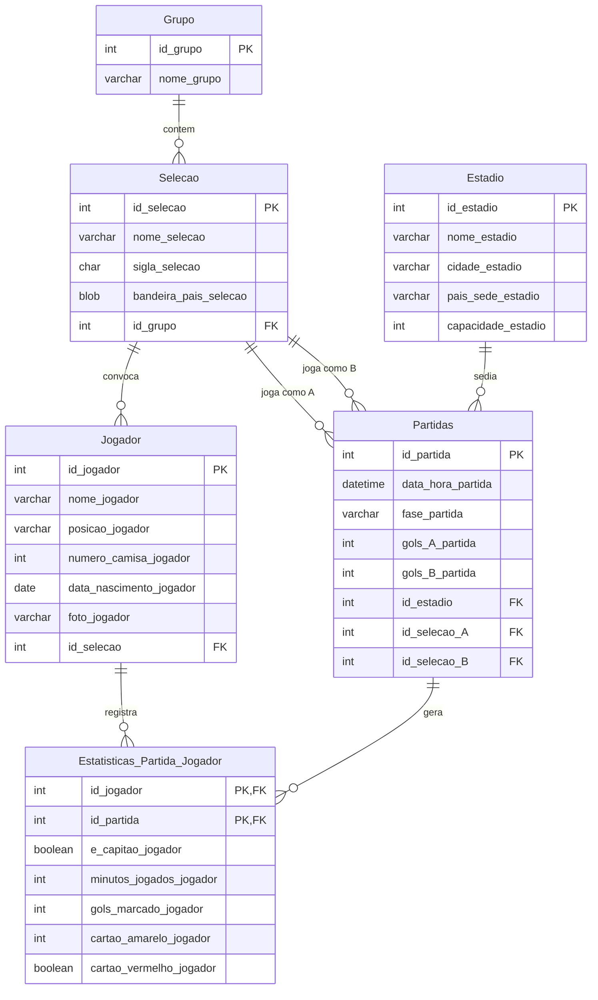
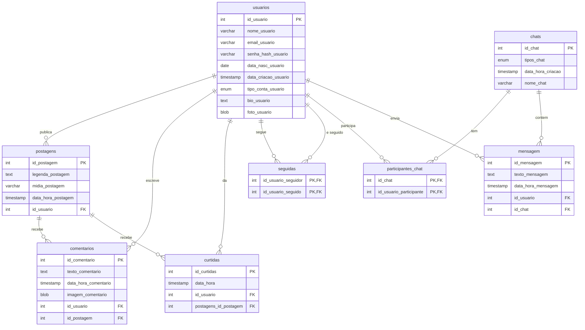

# Banco de Dados com MySQL

Modelagens e scripts SQL desenvolvidos nos meus estudos de banco de dados, usando **MySQL** e **MySQL Workbench**.

| Projeto | Conteúdo |
|---|---|
| [Copa do Mundo 2026](#copa-do-mundo-2026) | Modelo no Workbench, script de criação do banco e script de atualização de dados |
| [Rede Social](#rede-social) | Modelagem lógica no Workbench |

Os arquivos `.mwb` abrem no MySQL Workbench. Os diagramas abaixo são uma representação desses modelos.

---

## Copa do Mundo 2026

Banco para gerenciar a Copa: grupos, seleções, jogadores, estádios, partidas e as estatísticas de cada jogador por partida.

| Arquivo | Descrição |
|---|---|
| [schema.sql](copa-do-mundo-2026/schema.sql) | Cria o banco `copa_mundo_2026` com todas as tabelas, chaves primárias e estrangeiras |
| [atualiza_jogadores.sql](copa-do-mundo-2026/atualiza_jogadores.sql) | Atualiza os dados de vários jogadores em um único `UPDATE` com `JOIN` em uma tabela derivada (`UNION ALL`). Escrito para uma versão posterior do banco, que tem altura e peso dos jogadores |
| [modelo.mwb](copa-do-mundo-2026/modelo.mwb) | Modelo no MySQL Workbench |

Destaques da modelagem:

- `Partidas` se relaciona duas vezes com `Selecao` (time A e time B).
- `Estatisticas_Partida_Jogador` é uma tabela associativa (N:N entre jogadores e partidas) com chave primária composta.

---

## Rede Social

Modelagem lógica de uma rede social com usuários, postagens, comentários, curtidas, seguidores e chats.

| Arquivo | Descrição |
|---|---|
| [modelo.mwb](rede-social/modelo.mwb) | Modelo no MySQL Workbench |

Destaques da modelagem:

- `seguidas` é um autorrelacionamento N:N de `usuarios` (seguidor e seguido).
- A senha é armazenada como hash (`senha_hash_usuario`), nunca em texto puro.
- Chats podem ser diretos ou em grupo (`tipos_chat`), com participantes em tabela associativa.
- Contas podem ser públicas ou privadas (`tipo_conta_usuario`).

## Licença

[MIT](LICENSE)
